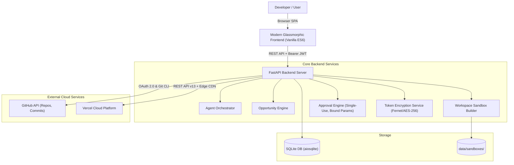

# ProblemPilot AI (Problem2Project AI)

> Autonomous, live-research real-world problem discovery and project-building intelligence platform.

ProblemPilot AI transforms natural-language prompts into verified problem opportunities, structured blueprints, full-stack working code, automated test verification, authenticated GitHub repositories, and authentic Vercel cloud deployments.

---

## 🚀 Key Features

1. **One-Prompt Problem Discovery**: Natural-language intent extraction parsing geography, domain, skills, and difficulty.
2. **Live Multi-Platform Research**: Automated data scraping and validation across HackerNews, Reddit, and Dev.to with source citations and evidence excerpts.
3. **Structured Competitor Analysis & Transparent 3-Factor Scoring**:
   - Evidence & Demand (Assessment A)
   - Developer Fit & Feasibility (Assessment B)
   - Business & Differentiation Potential (Assessment C)
4. **Three Operating Modes**:
   - **Autonomous Mode**: Conducts research, blueprints, and generates workspace code automatically, but strictly pauses at external/consequential actions (GitHub pushes, cloud deployments).
   - **Hybrid Mode (Default)**: Collaborative human-in-the-loop workflow requiring user review and approval before advancing across stages.
   - **Guided Mode**: Educational flow providing step-by-step mentor instructions and prompts for developers who want to write the code themselves.
5. **Backend-Enforced Approval Engine**:
   - Cryptographic parameter binding via SHA-256 (`compute_params_hash`).
   - Single-use approval consumption to prevent replay attacks.
   - Automatic 24-hour expiration window.
6. **Isolated Sandbox Workspaces**:
   - Clean separation in `data/sandboxes/`.
   - Generates FastAPI server (`server.py`), Pytest automated test suite (`test_suite.py`), and modern HTML5/CSS3/ES6 frontend (`index.html`, `styles.css`, `app.js`).
7. **Secure GitHub OAuth 2.0 Integration**:
   - Tamper-proof HMAC CSRF state tokens bound to user ID.
   - Encrypted credential storage at rest using AES-256 / Fernet.
   - Pre-push secret scanning catching exposed keys, private keys, and `.env` files.
   - Sanitized Git remotes preventing token persistence in local `.git/config`.
   - Verified remote repository creation (`private` by default) and latest commit verification.
8. **Authentic Vercel Cloud Deployment**:
   - Live token validation against Vercel API (`/v2/user`).
   - Project structure inspection (`hybrid_python_static`, `@vercel/python`, `@vercel/static`).
   - Deployment lifecycle tracking (`INITIALIZING` -> `BUILDING` -> `READY`).
   - Remote HTTP health check verification probe.
   - Persistent deployment history audit trail in database.

---

## 🛠️ Architecture



---

## ⚙️ Environment Configuration

Copy `.env.example` to `.env`:

```bash
cp .env.example .env
```

### Required Configuration Variables

| Variable | Description | Default / Example |
| :--- | :--- | :--- |
| `SECRET_KEY` | JWT signing secret & fallback crypto key | Random 32-byte hex string |
| `DATABASE_URL` | Async SQLite connection URL | `sqlite+aiosqlite:///./data/problem2project.db` |
| `GITHUB_REDIRECT_URI` | Exact OAuth authorization callback URL | `http://localhost:8000/api/integrations/github/callback` |

### GitHub OAuth 2.0 Integration

| Variable | Description | Where to Obtain |
| :--- | :--- | :--- |
| `GITHUB_CLIENT_ID` | OAuth App Client ID | GitHub Developer Settings |
| `GITHUB_CLIENT_SECRET` | OAuth App Client Secret | GitHub Developer Settings |
| `GITHUB_REDIRECT_URI` | Exact authorization callback URL | Set in GitHub OAuth App |
| `GITHUB_OAUTH_STATE_SECRET` | HMAC secret for tamper-proof state tokens | Optional (falls back to `SECRET_KEY`) |
| `GITHUB_TOKEN_ENCRYPTION_KEY` | AES-256 encryption key for tokens at rest | Optional (derived from `SECRET_KEY`) |

#### Step-by-Step GitHub OAuth Setup Guide

1. Log into GitHub and navigate to: **Settings &rarr; Developer Settings &rarr; OAuth Apps** ([https://github.com/settings/developers](https://github.com/settings/developers)).
2. Click **New OAuth App**.
3. Fill in:
   - **Application name**: `ProblemPilot AI`
   - **Homepage URL**: `http://localhost:8000` (or your domain)
   - **Authorization callback URL**: `http://localhost:8000/api/integrations/github/callback`
4. Click **Register application**.
5. Copy the **Client ID** and generate a **Client Secret**.
6. Paste into your `.env`:
   ```env
   GITHUB_CLIENT_ID=your_client_id_here
   GITHUB_CLIENT_SECRET=your_client_secret_here
   GITHUB_REDIRECT_URI=http://localhost:8000/api/integrations/github/callback
   ```
7. Start or restart the backend server.
8. Navigate to **Cloud & GitHub** in the app and click **Connect GitHub Account**.

---

### Vercel Cloud Hosting Integration

| Variable | Description | Where to Obtain |
| :--- | :--- | :--- |
| `VERCEL_TOKEN` | Personal or Team Access Token | Vercel Account Settings |
| `VERCEL_TEAM_ID` | Optional Team ID if deploying to team | Vercel Team Settings |
| `VERCEL_PROJECT_ID` | Optional Project ID | Vercel Project Settings |

#### Step-by-Step Vercel Setup Guide

1. Create or log into your account at [vercel.com](https://vercel.com).
2. Go to **Account Settings &rarr; Tokens** ([https://vercel.com/account/tokens](https://vercel.com/account/tokens)).
3. Click **Create Token**, give it a name (e.g. `ProblemPilot Deployer`), and select scope.
4. Copy the token and add it to your `.env`:
   ```env
   VERCEL_TOKEN=your_vercel_token_here
   ```
5. Navigate to **Cloud & GitHub** in the app and click **Verify Token** to confirm connection.
6. When building projects, select **Deploy to Cloud** &rarr; **Vercel** to deploy serverless endpoints and responsive UI with global Edge CDN.

---

## 🏃 Quick Start

### 1. Install Dependencies

```bash
python -m venv venv
# Windows:
.\venv\Scripts\activate
# Linux/macOS:
source venv/bin/activate

pip install -r requirements.txt
```

### 2. Initialize Database and Run Application

```bash
uvicorn backend.main:app --host 127.0.0.1 --port 8000 --reload
```

Open your browser at: **`http://localhost:8000`**

A default developer account is pre-seeded for zero-friction access:
- **Email**: `developer@problempilot.ai`
- **Password**: `ProblemPilot123!`

---

## 🧪 Testing & Verification

Run the automated verification test suites:

### 1. Complete GitHub OAuth & Vercel Cloud Deployment Tests
```bash
python test_integrations_complete.py
```
*Validates token encryption at rest, HMAC CSRF state validation, pre-push secret scanning, GitHub OAuth callbacks, Vercel token verification, project structure detection, deployment polling, health checks, approval replay protection, and deployment audit history.*

### 2. Complete 12-Milestone Platform Transformation Tests
```bash
python test_transformation.py
```
*Validates auth backward compatibility, one-prompt journey, 3-factor opportunity scoring, blueprint generation, isolated code generation, sandbox pytest runs, AI teacher, approval engine gates, and integration status reporting.*

### 3. Core Regression Suite
```bash
python test_suite.py
```
*Validates database persistence, platform scrapers, TF-IDF data science analyzer, and API endpoints.*

---

## 🔒 Security Architecture

- **Token Encryption at Rest**: GitHub tokens are never stored in plaintext. They are encrypted using AES-256 Fernet (`enc:v1:...`).
- **No Token Exposure**: API endpoints never return access tokens. Frontend state only receives connection metadata (`username`, `connected_at`, `scopes`).
- **Sanitized Git Remotes**: Git remote URLs embedding tokens during authenticated push are immediately sanitized to prevent tokens from residing in `.git/config` on disk.
- **Pre-Push Secret Scanner**: Detects exposed API keys, private cryptographic keys, database passwords, and `.env` files before commits can be made.
- **Single-Use Approvals**: Every approval has a cryptographic hash of action parameters (`action_params_hash`) and is marked consumed immediately upon execution to prevent replay attacks.
- **Audit Logging**: All OAuth connects, disconnects, approvals, and deployments are recorded in the `audit_logs` table.

---

## 📄 License

MIT License. Designed and built with ProblemPilot AI.

